# FollowUp Assistant

Sends your follow-up message (text, or text + image, with the person's first name) to each chat in your
**Meta Business Suite inbox**, one chat at a time. Chats you can't message, and chats named **"Facebook user"**,
are moved to **Done** automatically.

There are two versions so you can compare them. Both use the same "brain"
([`extension/engine.js`](extension/engine.js)), so they make exactly the same decisions.

| | **Option A: FollowUp Copilot by Rojie Jardio** (Chrome extension) | **Option B: FollowUp Desk** (Windows app) |
|---|---|---|
| Looks like | A side panel next to your normal Business Suite tab | Its own window, plus a Chrome window it controls |
| Install | Load one folder into Chrome (2 minutes) | Install Python once, then `install.bat` |
| Uses | Your normal Chrome and your normal login | A separate Chrome profile (log in once) |
| Clicks & typing | In-page events | Real mouse/keyboard input from Playwright |
| While it runs | Open Chrome with the **FollowUp Chrome** desktop icon (see below) so it keeps going after Alt+Tab. Don't minimize it. | Keeps running even when the window is behind other windows |
| Shows Meta it's automated? | Less visibly | Chrome shows "controlled by automated test software", and the browser reports it is automated |

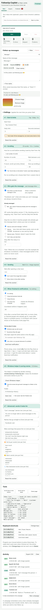

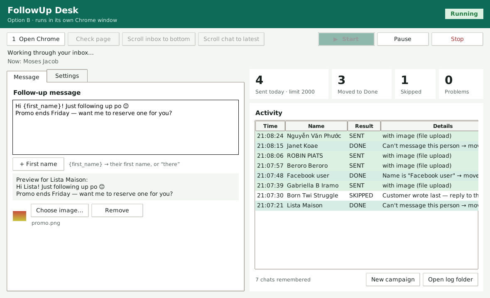

---

## What happens on every chat

```
open the chat ─► is it really this person? ── no ──► mark REVIEW, send nothing
                         │ yes
                         ▼
   "Facebook user"  or  "You are no longer able to send messages…"?
                         │ yes ─► click ✔ Move to done ─► next chat
                         │ no
                         ▼
   customer wrote last? ── yes ─► SKIP (you should answer them yourself; can be turned off)
                         │ no
                         ▼
   scroll to latest ─► put text in (with first name) ─► attach image ─► Send
                         ▼
   check the message really appeared in the chat ─► SENT ─► wait "seconds between chats" ─► next chat
```

Safety rules built into both versions:

* **Never messages the same chat twice** in a campaign, even after a restart, refresh or crash.
* **Never sends if it can't confirm the open chat is the right person.**
* **Never retries an unclear send.** If it isn't sure, it marks UNKNOWN and moves on.
* **Pauses** when Meta shows a warning (blocked, restricted, security check…).
* **Pauses after 3 problems in a row**, which usually means Meta changed the page.
* **Daily limit**, which you set. Seconds between chats is adjustable.

---

## Option A: install the Chrome extension

1. Download this project (green **Code** button → **Download ZIP**) and unzip it.
2. In Chrome, open `chrome://extensions`.
3. Turn on **Developer mode** (top right).
4. Click **Load unpacked** and choose the **`extension`** folder.
5. Pin the extension (puzzle icon → pin **FollowUp Copilot by Rojie Jardio**).
6. Open Business Suite → **Inbox** and click the extension icon. The side panel opens and connects by itself.
7. (Optional) Paste your inbox link from Chrome's address bar into **Your inbox link**. Then
   **Open my inbox** takes you straight there, and the app refuses to run on a different Facebook Page
   by mistake. The badge at the top says **Ready** when it's connected.

## New in 1.7.0 (extension)

### Stop when it reaches people who already got this message

Chats you message jump to the top of the inbox. So when a run reaches chats that already have this message,
it has reached the people from your last run, and everything above is done. **Settings → Already messaged:**

| Setting | Default | What it does |
|---|---|---|
| Don't send if FollowUp already sent this message to them | **Off** (works exactly like 1.6.0) | Never sends the same message twice: the name is on this message's list *and* the message is in the chat. An old broadcast with the same words (that FollowUp didn't send) still gets the follow-up. Shows **ALREADY** in Activity. |
| Stop by name and message | ✓ default | Counts a chat only when the name is on this message's list *and* the message is in the chat (safest) |
| Stop by message | | Any chat that already has these words counts, even an old broadcast or one sent by hand. Use it only if you never re-send the same words. |
| Stop by name | | Decides from the inbox list without opening the chat (fastest) |
| Don't stop, just skip them | | Goes on to the end of the inbox |
| Stop after this many in a row | 3 | One stray chat doesn't stop the run early. A newly sent chat starts the count again. Chats messaged earlier in the same run never count. |

When it stops this way, **When the run is finished** runs (for example the shutdown countdown).
The checks add almost no time: the name check reads the list, and the message check reads the chat the app
opens anyway.

**Names list per saved message.** Each saved message keeps its own list of who got it. **New campaign**
doesn't erase it (use **Clear names** under the message if you want to). With **Also save the names to a folder
on this PC** (default `D:\FollowUp-History`), the Windows helper writes one Excel-friendly file per message
plus `runs.csv` (one line per run), every 25 sends and at the end of each run. If Chrome ever loses its copy,
the names are loaded back from that folder. **Run `windows\Setup-FollowUp.bat` again once** to update the helper.

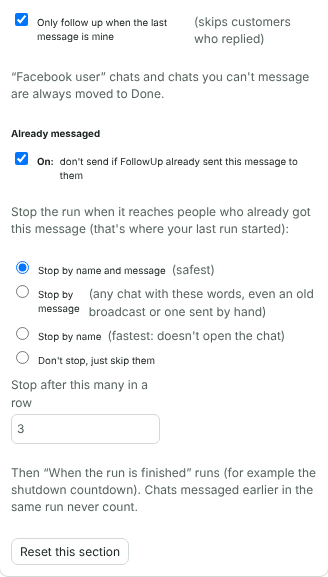

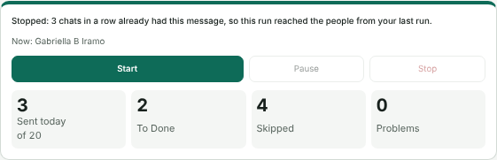

### Tell me when it's done (PC and phone)

**Settings → When the run is finished → Tell me when it's done:**

* **Windows pop-up with sound**: on by default.
* **My phone**: install the free **ntfy** app (Play Store / App Store), tap **+**, type a private topic name only
  you know, type the same name in Settings, then press **Send test notification**. Works even after the PC shuts down.
* **Also when a run pauses because of a problem**: on by default.

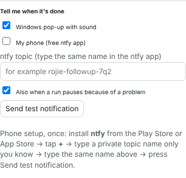

### Auto-replies to people who answer your follow-up (Buyers tab)

After **Check replies**, people who answered your follow-up get the reply for their type:
🔥 Hot, 🙂 Warm, ❄️ Not interested, 💬 Other. Each has its own text (with `{first_name}`) and image, and can be
turned off. Hot and Warm are on, with example texts to edit; Not interested and Other are off.

* **Ask me first**: the replies wait under **Ready to send**. Press **Skip** on any you don't want, then **Send all**.
* **Send automatically**: they go out right after the check.
* **Also check by itself every N minutes** while the inbox tab is open. If a follow-up run is going, it pauses
  after its current chat, answers, puts the inbox back where it was, and continues. Before a shutdown it does one
  last round.
* Nobody gets an auto-reply twice, and nobody you already answered yourself (if your message is the last one, it's skipped).

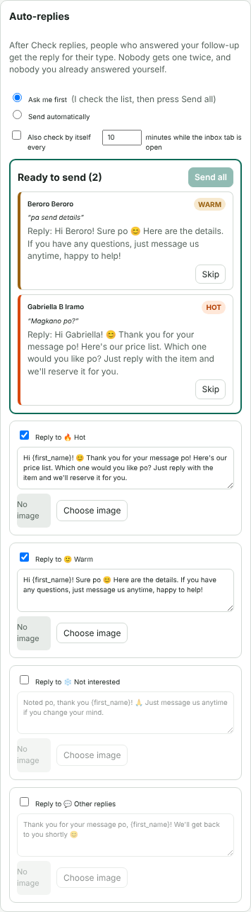

### "Facebook user" fix

"Facebook user" and "can't message" chats are now always moved to Done while they're still in the inbox. Before,
if a Done click didn't work, the chat was written down as handled and skipped on every later run.

## Option A: keep running after Alt+Tab, and shut down when done (Windows, one-time setup)

Normal Chrome slows down a tab you can't see, so sending stops when you Alt+Tab away. The **FollowUp Chrome**
icon opens your normal Chrome (same profile, same login) with three switches that turn that slowing off.

1. In the `windows` folder, double-click **`Setup-FollowUp.bat`**. If Windows says "Windows protected your PC",
   click **More info → Run anyway**. It:
   * puts a **FollowUp Chrome** icon on your desktop, and
   * installs a small helper that lets the extension shut down the PC (Chrome can't do that by itself).
2. Open `chrome://extensions` and click ↻ on FollowUp Copilot.
3. From now on, open Chrome with the **FollowUp Chrome** icon when you follow up. If Chrome is already open, it
   asks to close it first (the switches only work on a fresh start). Minimizing the window can still pause it;
   another window on top is fine.
4. **Settings → When the run is finished**: Do nothing / Close the Business Suite tab / Close Chrome /
   **Shut down the computer**. Press **Check shutdown helper**: it should say ✓. When a run finishes normally
   (daily limit reached or no more chats, never after Stop or a problem pause) a countdown with **Cancel** and
   **Do it now** shows on the page and in the side panel (60 seconds by default).

To remove both: double-click `windows\Uninstall-FollowUp.bat`.

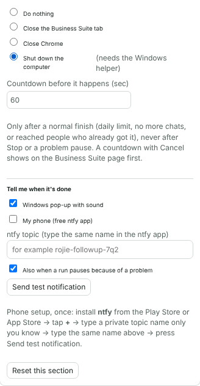

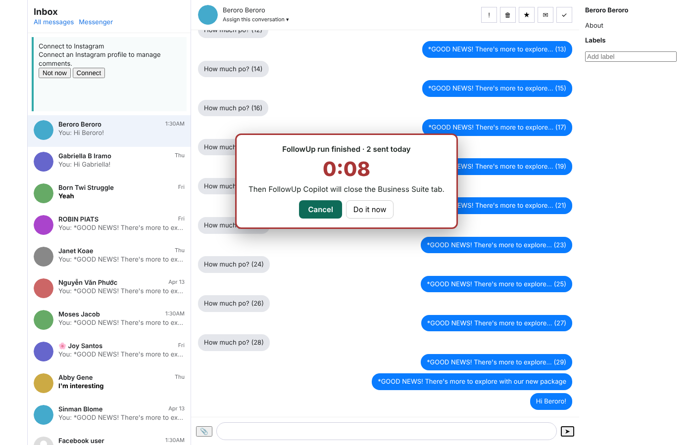

### Scrolling settings

**Settings → Scrolling** decides how far **Start from: Bottom** scrolls before it starts sending:

| Setting | Default | What it does |
|---|---|---|
| How far | A set number of scrolls | Or "until about N chats are loaded", or "all the way to the bottom" |
| Number of scrolls | 25 | Then it starts the follow-up right away from the lowest chat it loaded, going up |
| Wait between scrolls | 1.5 sec | Raise it if your internet is slow |
| If stuck: scroll up & retry | 2 times | Before deciding it reached the bottom |
| Give up scrolling after | 30 min | Then it starts sending from where it got to |
| The button uses these too | Yes | "Scroll inbox to the bottom" stops at the same place |

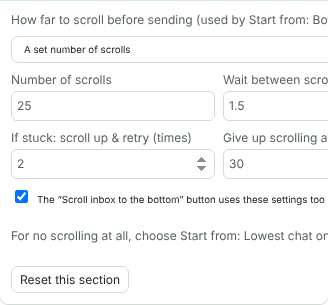

## Option B: install the Windows app

1. Install Python from <https://www.python.org/downloads/windows/>. **Tick "Add python.exe to PATH".**
2. Make sure Google Chrome is installed.
3. In the `desktop` folder, double-click **`install.bat`** (one time only).
4. Double-click **`run.bat`** to start FollowUp Desk.
5. Press **1 Open Chrome**. The first time, log in to Facebook in that Chrome window. It remembers you after that.
6. (Optional) Paste your inbox link under **Message → Your inbox link**. **Open Chrome** then goes straight to it.

(Optional) `build_exe.bat` makes a single `FollowUpDesk.exe`.

---

## Your first run (do this with either version)

1. Write your message. Click **+ First name** to add `{first_name}`. Choose an image if you want one.
2. Open the Business Suite **Inbox**, open any chat, and press **Check page**. Every line should say **✓ found**.
   If something says **✗ not found**, send me a screenshot of that line.
3. Turn on **Test mode** in Settings and press **Start**. It fills in the message and image on a few chats but
   **never presses Send or Done**. Watch that the right first name and image appear.
4. Turn Test mode off, set the **Daily limit to about 20**, and press **Start** for a real run.
5. When that works, raise the limit.

**To send from the bottom of the inbox going up:** in Settings choose **Start from: Bottom**.
When you press Start, the app first scrolls the inbox down as far as **Settings → Scrolling** says (25 scrolls by
default; you'll see "Scrolling to the bottom first… N of 25 scrolls"). Then it messages the lowest loaded chat
first and works upward to the top. Chats you message jump to the top of Business Suite's list, and the
app remembers them, so they're never messaged twice. Stop and Pause work while it scrolls.

**To start from a chat you choose:** scroll the inbox so that chat is the lowest one you can see, then use
**Start from: Lowest chat on screen now (no scrolling)**. It starts there and goes up; chats below it are left alone.

**Moving to Done is always on** for "Facebook user" chats and chats showing "You are no longer able to send
messages…" (except in Test mode). Chats you message are moved too only if you tick "Move chats to Done after sending".

**Tools work while a run is going or paused.** Check page and Scroll chat to latest work right away.
Scroll inbox to the bottom first pauses the run (after the chat it's on), then scrolls; press **Resume**
when you're done. Resume waits until the scrolling has finished, been paused or been stopped.

If the inbox stops loading while scrolling down, the app scrolls up a little and back down (twice) before
deciding it reached the bottom, the same thing you'd do by hand.

**Scroll inbox to the bottom** (the separate button) can also be paused: press it once to start, again to
**Pause scrolling**, again to **Resume scrolling**. **Stop** ends it.

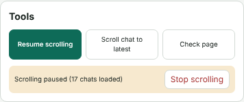

### Keyboard shortcuts (and mouse buttons)

| Keys | What it does |
|---|---|
| **Ctrl+Shift+1** | Start sending → Pause → Resume (one key does all three) |
| **Ctrl+Shift+2** | Stop (sending, or scrolling) |
| **Ctrl+Shift+3** | Scroll inbox to the bottom → Pause → Resume |
| **Ctrl+Shift+4** | Scroll the open chat to the latest message |

**To use mouse buttons:** in your mouse software (Logitech G HUB, Razer Synapse, Bloody, A4Tech and so on),
set a button to press one of these key combinations, the same way you set up your current macro. It's best
to set it on a button that isn't "Back", because Chrome also uses Back to leave the page.

* **Option A (extension):** the keys work while Chrome is the active window. To make them work **from any
  window**, click **Change keys** in the side panel (or open `chrome://extensions/shortcuts`) and switch
  each one from "In Chrome" to **Global**. You can also pick different keys there. A small green note
  appears at the bottom of the Business Suite page each time a shortcut is used.
* **Option B (desktop app):** the keys work from **any window** already. Change them under
  **Settings → Keyboard shortcuts** (type e.g. `Ctrl+Alt+S` or `F8`), then press **Apply shortcuts**.

If you install both versions, give them different keys so one key press doesn't control both.

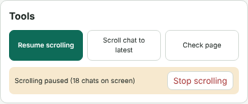

### Settings, in folding sections (1.7.3)

Settings is split into 7 sections in the order you set up a run. Each closed section shows its current values on
one line, so you can check everything without opening anything. Open only the one you need; the panel remembers
which ones you left open. Each section has **Reset this section** (your ntfy topic is never reset).

1. Start & limits · 2. Scrolling · 3. Who gets the message (incl. Already messaged) · 4. Sending ·
5. When finished & notifications · 6. Windows helper & saving names · 7. Advanced: words it looks for

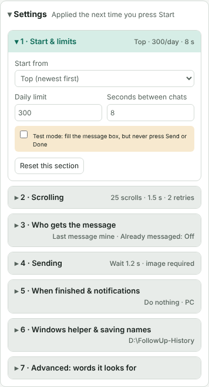

### Settings, in plain words

| Setting | What it does |
|---|---|
| Seconds between chats | Pause after each sent message |
| Wait after opening a chat | Time for the chat to load before reading it. Raise it if your internet is slow. |
| Daily limit | Stops after this many sends today |
| Start from | **Top**: newest first. **Bottom**: scrolls down first (see Scrolling settings), then goes up. **Lowest chat on screen**: starts at the bottom chat you can see right now (no scrolling down), goes up, and leaves the chats below it alone |
| Only follow up when the last message is mine | Skips people who replied to you, so you can answer them personally |
| Move chats to Done after sending | Also moves successfully messaged chats to Done |
| Don't send if the image fails to attach | Skips that chat instead of sending text only |
| Test mode | Does everything except pressing Send / Done |
| Advanced | The exact words it looks for, in case Meta changes them or your Business Suite is in another language |

### Saved messages (extension)

Keep several follow-up messages, each with its own name and image. Use **+ New** to add one and the drop-down
to choose which one the next run sends. Under each message you see how it did: **Sent**, **Replied (%)** and
**🔥 Hot**.

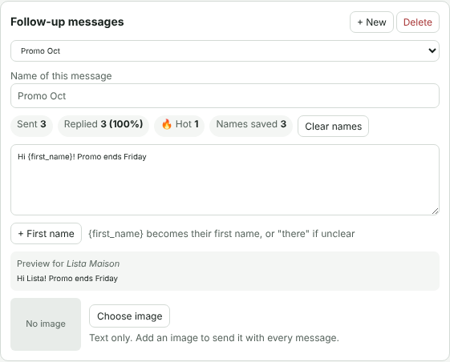

### Buyers tab: who replied and who wants to buy (extension)

Press **Check replies** a few hours or days after a run. The app reads your inbox list (it doesn't open chats)
and finds the people you followed up who wrote back. It sorts them by what they wrote:

| | Examples of words it looks for |
|---|---|
| 🔥 **Hot** | how much, hm, magkano, price, order, COD, available, saan, location, reserve, gcash |
| 🙂 **Warm** | interested, details, pa send, sige, ok, pwede, pics |
| ❄️ **Not interested** | not interested, no thanks, wag na, ayoko, stop |
| **Replied** | anything else |

Change the words under **Settings → Advanced**. Each person has an **Open chat** button. With
"add this label to hot leads" ticked (the default), hot leads also get the **Hot lead** label in Business
Suite, so you can find them in the inbox. **Label hot leads** does the same on demand. If a label can't be
added, the Problems tab says why and how to fix it.

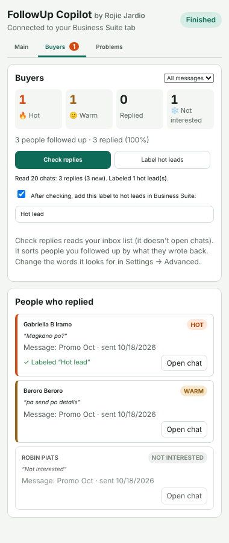

### When something goes wrong: the Problems tab

Every problem is listed in the **Problems** tab (in both versions) with **what happened**, **why**, and
**how to fix it**. If 3 problems happen in a row, the run pauses and the message at the top says the same,
with a button that opens the Problems tab. Fix the cause, then press **Resume**.

After pressing Send, the app checks that the message appeared in the chat or in that chat's preview in the
list ("You: …"). If it can't see it but the message box emptied and Meta showed no error, it still counts as
**Sent**, with a note in the Activity list. That isn't a problem, so it doesn't pause.

**New campaign** makes the app forget who it already messaged. Use it when you start a new follow-up message.

---

## Please read: limits and risks

* **Tested on a practice copy of Business Suite, not on your real account.** I can't log in to your Facebook,
  so I built [`tests/mock_inbox.html`](tests/mock_inbox.html) from your screenshots. Meta's real page may label
  buttons differently. **Check page** and **Test mode** are there so you can confirm it on the real inbox before
  anything is sent.
* **It is not undetectable.** Every message goes through Meta's servers, whichever version you use. Neither version
  hides that it's automated. Meta mostly reacts to *volume* and to *recipients blocking or reporting* you. 2,000
  messages a day is high; if Meta shows a warning, the app pauses. Don't push past it.
* **Meta's reply window can't be bypassed.** Chats showing "You are no longer able to send messages…" are closed
  by Meta. The app moves them to Done and continues.
* When Meta redesigns the inbox, the app may stop finding a button. It will pause and tell you which part is
  missing, and the words under **Advanced** can usually fix it.

---

## For developers

```
extension/        Option A: Manifest V3 extension (engine.js, content.js, side panel)
windows/          Option A on Windows: FollowUp Chrome launcher + shutdown helper (native messaging host)
desktop/          Option B: tkinter window (followup_desk.py), Playwright controller (bridge.py), shortcuts (hotkeys.py)
tests/            practice inbox + automated tests (engine, extension, desktop controller, desktop window, shortcuts)
```

Run the tests (Python 3.10+):

```
pip install playwright==1.56.0 pytest pillow pynput
python -m playwright install chromium
python -m pytest tests            # on Linux, run the window test with: xvfb-run python -m pytest tests
```
