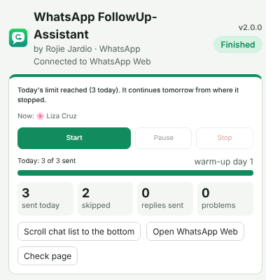
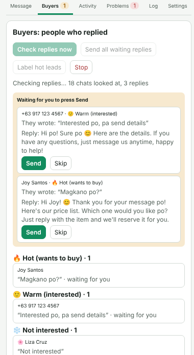
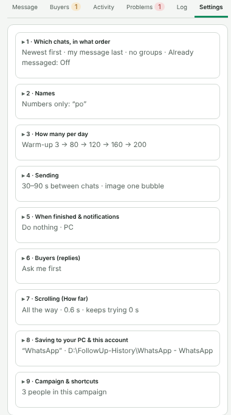
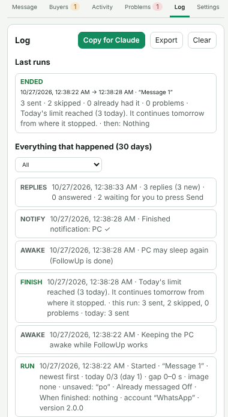

# WhatsApp FollowUp-Assistant (by Rojie Jardio)

Follows up your **existing WhatsApp chats** on WhatsApp Web, one by one: your message with the person's first
name, your image, from the newest or the oldest chats. Then it helps you answer the people who reply.
It is a separate app from FollowUp Copilot (Business Suite), with its own icon.

## Install (once in each Chrome profile)

1. Make one Chrome profile per WhatsApp account (profile picture at the top right of Chrome → **Add**), for example
   "WhatsApp" and "WA Business".
2. In each profile: `chrome://extensions` → **Developer mode** on → **Load unpacked** → choose the `whatsapp-extension`
   folder inside `WhatsApp FollowUp-Assistant`.
3. Open `web.whatsapp.com` in that profile and link it: on your phone, WhatsApp → **Linked devices** → **Link a device**.
4. Click the FollowUp icon (green chat bubble with an arrow). Paste your message and choose your image.
5. Settings → **8 · Saving to your PC & this account**: give each profile its own name (e.g. "WA Business").
6. First time: Settings → 4 → tick **Test mode**, press Start, watch a few chats get filled in, then Stop.
   Press **Check page**: every line should say ✓. Then untick Test mode.
7. Double-click `windows\Setup-FollowUp.bat` once (for shutdown and saving to your PC). It finds this app and
   FollowUp Copilot both.

## What's in it

* **Message with the first name** · numbers only get your own word ("Hi po!") · optional "~name".
* **Image** in one bubble (image with the message under it) or two bubbles.
* **Start from**: newest first · oldest first (all the way, or as far as "How far" says) · lowest chat on screen.
* **How many per day**: warm-up plan 50 → 80 → 120 → 160 → 200 (you can change it), the same every day, or "Today only".
* **Safe sending**: only chats where your message is last, no groups, random 30–90 s between chats, stops if WhatsApp
  shows a warning, pauses after 3 problems in a row, never the same person twice (campaign).
* **Stop when it reaches people who already got this message** (by name / message / both), then shut down if you want.
* **Buyers tab**: finds who replied, sorts them 🔥 Hot / 🙂 Warm / ❄️ Not interested / 💬 Other, and sends your ready
  reply. **Ask me first** (you press Send) or automatic, optional check every few minutes (also during a run).
  WhatsApp Business: adds a "Hot lead" label.
* **Log tab**: every run, why it ended, pauses, hidden window, PC asleep; kept 30 days; Copy for Claude; Export.
* **Saving to your PC** (with the Windows helper): who got each message in `D:\FollowUp-History\WhatsApp - <account>`
  (one file per message), and the day's Log as `log-YYYY-MM-DD.txt`. If Chrome forgets the names, they come back.
* **Today's counters**, **Activity** with **Export CSV**, **Problems** with what/why/fix.
* **Scroll chat list to the bottom** button, **How far**, **keep trying at the bottom**.
* **Settings in folding sections**, each with its values on one line and **Reset this section**.
* **Keyboard shortcuts**: Ctrl+Shift+5 Start/Pause/Resume · Ctrl+Shift+6 Stop · Ctrl+Shift+7 Scroll
  (change them at `chrome://extensions/shortcuts`).
* PC and phone notifications, keep the PC awake, When finished: close the tab, close Chrome or shut down.

## Please read

WhatsApp's rules don't allow automated or bulk messages. What gets numbers banned is mostly how many messages go out
and how many people block or report you. Keep to people who already chatted with you, use the warm-up plan, and keep
the random gaps.
